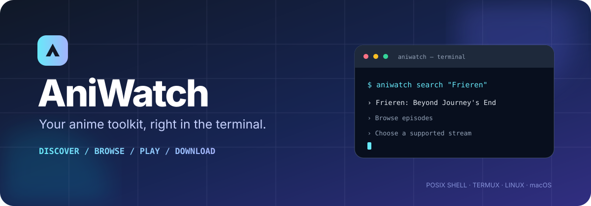

<div align="center">



<br>

[](https://github.com/Kaztral-ar/ani-watch/actions/workflows/ci.yml)
[](LICENSE)
[](https://github.com/Kaztral-ar/ani-watch/stargazers)
[](https://github.com/Kaztral-ar/ani-watch/issues)

**A lightweight anime discovery and playback CLI built for your terminal.**

[Get Started](#-quick-start) · [Features](#-features) · [Commands](#-command-center) · [Configuration](#-configuration) · [Contributing](#-contributing)

</div>

---

## ✦ About AniWatch

**AniWatch** brings anime discovery, episode browsing, metadata lookup, and supported media playback into one command-line workflow.

Search titles through HiAnime, explore episodes, discover anime information with Jikan, then play or download media that your local tools can access.

> Built for people who prefer a fast terminal workflow — including Android users running Termux.

## ⚡ Features

<table>
<tr>
<td width="50%" valign="top">

### 🔎 Discover
- Search anime titles
- Browse episode listings
- View available server labels
- Explore popular and seasonal anime
- Look up detailed anime metadata

</td>
<td width="50%" valign="top">

### ▶️ Watch
- Interactive terminal navigation
- MPV or VLC playback
- Accessible HLS playlist support
- Japanese / English audio preference
- Selectable video quality

</td>
</tr>
<tr>
<td width="50%" valign="top">

### 📥 Download
- Direct media downloads
- HLS download and remux
- Episode range downloads
- Subtitle download support
- Configurable download directory

</td>
<td width="50%" valign="top">

### 🧰 Make it yours
- Watch history and resume
- fzf-powered selection
- Syncplay support
- Optional Ani-Skip integration
- POSIX shell implementation

</td>
</tr>
</table>

## 🚀 Quick start

### 1 · Install dependencies

<details open>
<summary><b>Android — Termux</b></summary>

```sh
pkg update
pkg install git make curl jq fzf yt-dlp mpv
```

</details>

<details>
<summary><b>Linux — Ubuntu / Debian</b></summary>

```sh
sudo apt update
sudo apt install git make curl jq fzf yt-dlp mpv
```

</details>

<details>
<summary><b>macOS — Homebrew</b></summary>

```sh
brew install git make curl jq fzf yt-dlp mpv
```

</details>

### 2 · Clone and install

```sh
git clone https://github.com/Kaztral-ar/ani-watch.git
cd ani-watch
make install PREFIX="$HOME/.local"
```

Make sure `$HOME/.local/bin` is in your `PATH`.

### 3 · Launch

```sh
aniwatch
```

<details>
<summary><b>Prefer not to install?</b></summary>

Run directly from the cloned repository:

```sh
./bin/aniwatch
```

</details>

### Optional dependencies

| Tool | Purpose |
|---|---|
| `ffmpeg` | HLS fallback/remux and subtitle embedding |
| `vlc` | Alternative media player |
| `syncplay` | Synchronized viewing |
| `ani-skip` | Intro/outro skipping with MPV |

## 🎮 Command center

Run `aniwatch help` to see the complete built-in help.

### Discover anime

```sh
# Interactive mode
aniwatch

# Search titles on HiAnime
aniwatch search "Frieren"

# Browse episodes and server labels
aniwatch episodes <anime-id-or-slug>
aniwatch servers <episode-id>

# Explore Jikan metadata
aniwatch metadata-search "Frieren"
aniwatch top
aniwatch random
aniwatch season
aniwatch season 2026 fall
aniwatch info <mal-id>
```

### Play and download

```sh
# Play a supported media URL
aniwatch watch "<media-url>" 1080p sub

# Download a supported media URL
aniwatch download "<media-url>" 720p dub

# Play / download an accessible HLS playlist
aniwatch hls "<playlist.m3u8>" 720p
aniwatch hls-download "<playlist.m3u8>" best

# Download episodes 1 through 12
aniwatch bulk-download <anime-slug> 1-12 sub 720p
```

**Quality options:** `best`, `worst`, `360p`, `480p`, `720p`, `1080p`

**Audio preference:** `sub` (Japanese) or `dub` (English), where the source provides the requested option.

### History and watch together

```sh
aniwatch history
aniwatch continue
aniwatch history-clear
aniwatch syncplay "<media-url>"
```

## ⚙️ Configuration

All settings can be supplied as environment variables.

| Variable | Default | Description |
|---|---|---|
| `ANIWATCH_PLAYER` | `mpv` | Playback program: `mpv` or `vlc` |
| `ANIWATCH_QUALITY` | `best` | Default quality |
| `ANIWATCH_MODE` | `sub` | Default audio preference |
| `ANIWATCH_SKIP_INTRO` | `0` | Set to `1` for MPV Ani-Skip integration |
| `ANIWATCH_DOWNLOAD_DIR` | `.` | Download destination |
| `ANIWATCH_STATE_DIR` | `~/.local/state/aniwatch` | History and state directory |
| `ANIWATCH_HIANIME_BASE` | `https://hianime.at` | HiAnime base URL |
| `ANIWATCH_API_URL` | `https://api.jikan.moe/v4` | Jikan API base URL |
| `ANIWATCH_SYNCPLAY_SERVER` | `syncplay.pl:8995` | Syncplay server |

<details>
<summary><b>Configuration examples</b></summary>

```sh
# Switch to VLC
ANIWATCH_PLAYER=vlc aniwatch

# Set default quality and audio mode
ANIWATCH_QUALITY=720p ANIWATCH_MODE=dub aniwatch

# Enable Ani-Skip (MPV only)
ANIWATCH_SKIP_INTRO=1 aniwatch

# Change download folder
ANIWATCH_DOWNLOAD_DIR="$HOME/Videos/Anime" aniwatch
```

</details>

## 🧱 Under the hood

| Component | Role |
|---|---|
| POSIX `sh` | Main application and shell portability |
| HiAnime | Title search, episode data, server listings |
| Jikan API | Anime metadata and seasonal discovery |
| `fzf` | Interactive terminal selection |
| `yt-dlp` | Supported stream extraction and downloads |
| MPV / VLC | Media playback |
| `ffmpeg` | HLS processing and subtitle embedding |

## ⚠️ Important limitations

- Playback requires a direct media URL or HLS playlist accessible to the installed player or downloader.
- A provider server listing does **not** guarantee that a playable media URL is available.
- Opaque embed identifiers and protected stream sources are not resolved.
- AniWatch does not bypass DRM, decrypt protected embeds, or circumvent access controls.
- HiAnime is an unofficial provider integration. Its pages and endpoints may change or stop working.
- Use the software and media sources in accordance with applicable laws and provider terms.

## 🧪 Development

```sh
git clone https://github.com/Kaztral-ar/ani-watch.git
cd ani-watch

# Run regression tests
make test

# Build the standalone executable
make build
```

CI checks shell syntax, ShellCheck, tests under `sh`, `dash`, and BusyBox `ash`, and the standalone build.

## 🤝 Contributing

Contributions, bug reports, and practical improvements are welcome.

1. Check the [open issues](https://github.com/Kaztral-ar/ani-watch/issues).
2. Open an issue to discuss larger changes.
3. Submit a focused pull request with a clear description and tests where possible.

## 📄 License

AniWatch is released under the [MIT License](LICENSE).

---

<div align="center">

**If AniWatch is useful, consider giving the project a ⭐**

[⭐ Star on GitHub](https://github.com/Kaztral-ar/ani-watch) · [🐛 Report a bug](https://github.com/Kaztral-ar/ani-watch/issues) · [📚 Source code](https://github.com/Kaztral-ar/ani-watch)

<sub>Made for the terminal. Powered by open source.</sub>

</div>
